<div align="center">


# Bhippi Video Editor

**The desktop video editor with an AI producer built in.** Windows 10/11 (x64). MIT licensed — free forever, no account, no license key, no credits.

Version 1.0.24

[](https://github.com/memegyanfactory-gif/bhippi-Video-editor/releases/latest)
[](https://discord.gg/WY3XNWdf9B)
[](LICENSE)
[](https://tauri.app)
[](https://www.rust-lang.org)
[](https://react.dev)
[](https://ffmpeg.org)

[⬇ Download for Windows](https://github.com/memegyanfactory-gif/bhippi-Video-editor/releases) · [💬 Join our Discord](https://discord.gg/WY3XNWdf9B) · [Website](https://bhippi.com) · [What's new](#-whats-new) · [Model Library](#-model-library-local-ai-models-in-one-place) · [Quick Start](#quick-start) · [How it Works](#how-the-ai-works) · [Features](#what-it-does) · [Comparison](#how-it-compares) · [Documentation](#architecture--codebase)

---

</div>

<p align="center">
  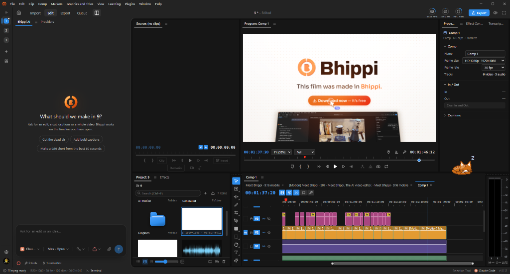
  <em>Bhippi Video Editor v1.0.13 in action: multi-track timeline with cut blocks & audio waveforms, dual monitors, project bin, audio VU meters, and the connected AI co-pilot.</em>
</p>

---

## 🎬 Overview

**Bhippi Video Editor** combines the precision of a professional desktop Non-Linear Editor (NLE) with an autonomous AI producer. 

Unlike simple prompt-to-video wrappers, Bhippi gives you a full professional editing suite—unlimited video and audio tracks, ripple and roll edits, bezier-eased keyframes, nested compositions, and real-time waveforms. Operating alongside your timeline is an AI co-pilot that can plan, research, download assets, cut on speech, snap to music beats, apply motion graphics, rotoscope subjects, and review frames.

**Everything runs on your machine:** your footage, your models, and your render. No forced subscriptions, no cloud queue, and no token caps on your own hardware.

---

## 🆕 What's new

| Version | What changed |
| :--- | :--- |
| **1.0.24** | **Closing Bhippi closes everything it started.** Local language models, ComfyUI video and image models, Blender, FFmpeg, AI agent CLIs, MCP servers, the capture browser and commands the AI ran all end with Bhippi, even after a crash (Windows job objects). Your own browser, Ollama, LM Studio and the update installer are left alone. |
| **1.0.23** | **3D renders as layers, CPU/RAM limits, any provider more reliable.** A Blender render arrives as one layer per object plus Shadow and Background, matching the single render, so any object can be hidden, graded or retimed. Settings › General › Performance caps Bhippi's heavy work (llama.cpp, ComfyUI, Blender, FFmpeg) at 75% CPU and memory by default, enforced by Windows. Silent or stalled agents restart, models that stop mid-task are nudged on, and an unfinished production gets Bhippi's own polish (black edges, mix level, the Judge). |
| **1.0.22** | **Local language models just work.** Bhippi checks how much text a local model can read and, when its full request would not fit, sends a compact one (a few core tools plus "find tools" for the 200+ others), so "hi" to a 16K model costs about 6K tokens instead of 92K. Local models start with a 32K context when the PC can hold it, with a Context choice next to Start; a model's sizes each show their own download status. |
| **1.0.21** | **Downloads page and queue.** See what is downloading, waiting, paused, failed and finished; pause any download and resume it later from where it stopped, even after closing Bhippi. Hugging Face downloads always show what is happening, and draft/MTP helper files are no longer offered as models. [Details ↓](#downloads-queue-pause-and-resume) |
| **1.0.20** | **Model Library**: every local AI model in one place, with thumbnails, a fit check for your PC, one-click downloads and an **In use** page that decides which model the AI uses for each job. New models: MiniMax H3 (video with sound), Z-Image Turbo, FLUX.2 klein, Qwen-Image 2.1, ACE-Step 1.5, Stable Audio 3, YuE 2, 45 more voices and 15 Whisper sizes. Local language models from Hugging Face, Qwen3.8 Flash Next through Strata, and Hugging Face sign-in for gated models. Also a new **Brand Studio** and a 3D **Brain**. |
| **1.0.19** | **Agent activity** reads like Claude Code: a tree of steps, times that roll over (42s, 2m 05s, 2h 54m), the model that answered ("Claude Code · Opus 5.5") and the program a command runs, with its logo ("Blender · Rendering scene.blend"). |
| **1.0.18** | **Brain**: Settings → Brain shows what Bhippi has learned as a brain, one lobe per kind of knowledge, with a "Is it getting better?" success rate and cleaner learning from failed tool calls. |

Every release is on the [Releases page](https://github.com/memegyanfactory-gif/bhippi-Video-editor/releases) with its SHA-256, and installed copies update themselves from inside the app.

---

## 📽️ UI & Motion in Action

<div align="center">
  <table>
    <tr>
      <td width="50%" align="center">
        <strong>⚡ Intelligent First Cut & Speech Sync</strong><br /><br />
        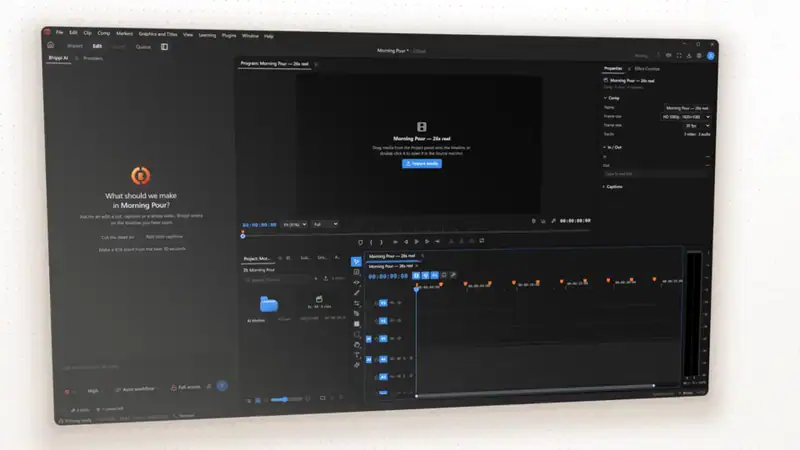<br />
        <em>The AI analyzes spoken dialogue, cuts dead air, and places synchronized titles automatically.</em>
      </td>
      <td width="50%" align="center">
        <strong>🎞️ Responsive Multi-Track Timeline</strong><br /><br />
        <br />
        <em>Smooth scrubbing, snapping, ripple/roll trimming, slip/slide, and live audio scrubbing.</em>
      </td>
    </tr>
  </table>
  <p>
    📹 <em>Full video clips available: <a href="docs/assets/first-cut-demo.mp4">first-cut-demo.mp4</a> · <a href="docs/assets/timeline-demo.mp4">timeline-demo.mp4</a></em>
  </p>
</div>

---

## ✨ What it does

### 1. Edit like a pro
- **Industry-standard toolset:** Selection, Razor (`C`), Ripple Edit (`B`), Rolling Edit (`N`), Rate Stretch (`R`), Slip (`Y`), Slide (`U`), Pen (`P`), and Type (`T`).
- **Deep timeline control:** Unlimited video and audio tracks, nested sequences, track grouping, master volume, real-time audio meters (dBFS / LUFS), and full undo/redo for every action—including operations executed by the AI.
- **Precision snapping:** Snap cuts to playhead, clip boundaries, markers, or detected musical beats and bar phrases.

### 2. Autonomous AI producer with phase control
- **Collaborative production workflow:** The co-pilot breaks production into transparent, controllable phases:
  $$\text{Plan} \longrightarrow \text{Gather} \longrightarrow \text{Edit} \longrightarrow \text{Polish}$$
- **Full vs. Quick turns:** Need a minor tweak? Click a layer or draw an annotation on the preview monitor—a **Quick turn** focuses only on that element without recalculating a full video blueprint.
- **Persistent AI work:** All generated scripts, storyboards, voice-overs, and frame QA logs stay organized inside your project's `AI Work` bin. Closing the application never loses progress.
- **Over 200 native AI tools:** The AI interacts with your timeline through undoable API calls (`place_clip`, `snap_cuts_to_beats`, `level_audio`, `create_motion_scene`).

### 3. Local media generation — zero cloud credits
Everything here is downloaded and switched on from the [Model Library](#-model-library-local-ai-models-in-one-place).
- **Video:** MiniMax H3 (video *with* its own dialogue, sound and music), LTX-2.3, LTX-Video, Wan 2.2 and Wan 2.1.
- **Images:** Z-Image Turbo, FLUX.2 [klein] 4B, ERNIE-Image Turbo, Qwen-Image 2.1 (and Turbo), Qwen-Image Edit 2511, FLUX.1 schnell and SDXL.
- **Music & sound:** ACE-Step 1.5 (songs with vocals), YuE 2, Stable Audio 3 Medium and Stable Audio Open.
- **Voice & transcription:** Kokoro and Piper voices (50+ voices, Hindi included), Kitten TTS, Matcha-TTS, and 15 Whisper sizes.
- **Rotoscoping & mattes:** Segment Anything 2.1, Robust Video Matting, ViTMatte, Depth Anything 3 and people tracking.
- **Magic Eraser:** Object removal and clean-plate inpainting powered by LaMa.
- **Language models:** run the AI co-pilot itself on your PC with llama.cpp or Strata (Qwen, Gemma, gpt-oss, GLM and anything from Hugging Face).

### 4. GPU motion engine & After Effects-grade graphics
- **WebGL2 Compositor:** Unified motion engine rendering identical frames in both preview and final export.
- **Keyframe animation:** Bezier easing, parenting, track mattes, 17 blend modes, and motion blur.
- **2.5D Camera:** True 3D spatial layers with focal length and depth of field.
- **Vector shape trees:** SVG path morphing, trim paths, gradient strokes, repeaters, and 2,100+ Lucide icons.
- **60+ Motion templates:** Kinetic typography, fly-through words, lower thirds, stat charts, and brand lockups. See [docs/MOTION-ENGINE.md](docs/MOTION-ENGINE.md).

### 5. Headless Blender 3D integration
- When [Blender 4.2+](https://www.blender.org) is detected on your machine, Bhippi can orchestrate headless 3D renders in the background:
  - Glass and chrome orbs, extruded 3D logos, floating device mockups, and crystal refraction.
  - Fast draft previews using EEVEE; final broadcast renders with GPU Cycles raytracing.
  - Transparent alpha passes composite automatically under your 2D timeline layers.

### 6. HTML/CSS motion graphics & React Bits library
- **Crimson Design System:** Premium hook cards, side panels, comparison boards, and animated lower thirds.
- **React Bits & Modern UI:** Deterministic, exportable web animations—including the full 205-piece React Bits catalogue, Magic UI, and Aceternity components. See [docs/REACT-BITS-LIBRARY.md](docs/REACT-BITS-LIBRARY.md).

### 7. Brand Kits & Sound Design
- **Consistent brand identity:** Save your brand colors, fonts, voice tone, layout guidelines, and logos once in **Settings → Brand kit**. The AI automatically applies them to all generated graphics, voice styles, and captions. See [docs/BRAND-KIT.md](docs/BRAND-KIT.md).
- **Built-in SFX synthesizer:** 24 procedural sound effects (UI ticks, typing beds, glass pings, sub-bass drops, whooshes) automatically ducked beneath dialogue and music.

---

## 🧩 Model Library: local AI models in one place

**Settings → Model Library** is where every AI model that runs on your own PC lives: video, image, music, voice, transcription, cutouts and language models. You see what each model does, whether it fits your computer, download the size you want, and choose which one Bhippi's AI uses. Nothing is sent to a cloud, and nothing is used until you turn it on.

<div align="center">
  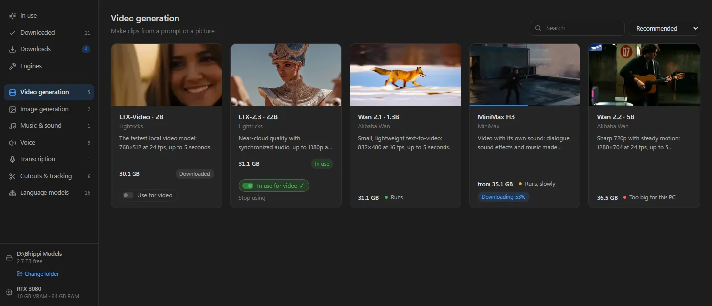<br />
  <em>The library, by category. Each card shows a picture, what the model does, its size and a fit dot for this PC.</em>
</div>

### Browse by what you want to make

The left rail groups models by job: **Video generation**, **Image generation**, **Music & sound**, **Voice**, **Transcription**, **Cutouts & tracking** and **Language models**. Above them are four pages that work across all models:

| Page | What it is for |
| :--- | :--- |
| **In use** | One row per job (video, image, music, voice, transcription, cutouts, language model). Pick the downloaded model the AI should use for that job, or **None**, which means the AI does not do that job locally. |
| **Downloaded** | Everything on this PC, with its size on disk, what it is used for, and Delete. |
| **Downloads** | What is downloading, waiting, paused, failed and finished ([below](#downloads-queue-pause-and-resume)). |
| **Engines** | The programs that run the models: a managed ComfyUI, llama.cpp, Strata, and your Hugging Face sign-in. |

### Know before you download

<div align="center">
  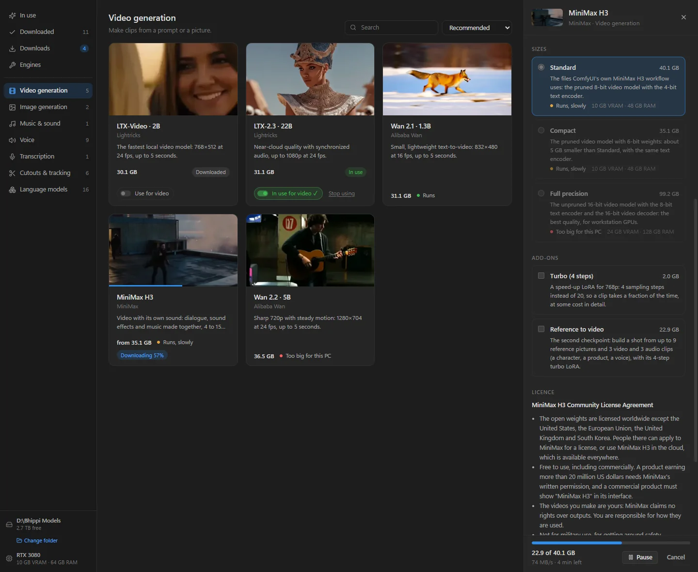<br />
  <em>A model's panel: sizes, what it needs, the licence in plain words, and live download progress.</em>
</div>

- **Fit for this PC.** Bhippi reads your graphics card memory, system RAM and free disk space, and labels each size *Runs well*, *Slow* or *Too big for this PC*, with the reason. The size that suits your PC is picked for you.
- **Sizes.** Models come in several sizes (for example MiniMax H3 *Compact*, *Standard* and *Full*, or a language model's Q2 to Q8 quantizations). Smaller is faster and lighter; bigger is higher quality.
- **Licences in plain words.** Open licences (Apache, MIT and similar) download straight away. A model with a restrictive licence shows its summary first and asks you to accept it once.
- **Storage.** Models go to a folder you choose (**Change folder**, for example a big D: drive). Models already downloaded keep working where they are.

### Choose what the AI uses

<div align="center">
  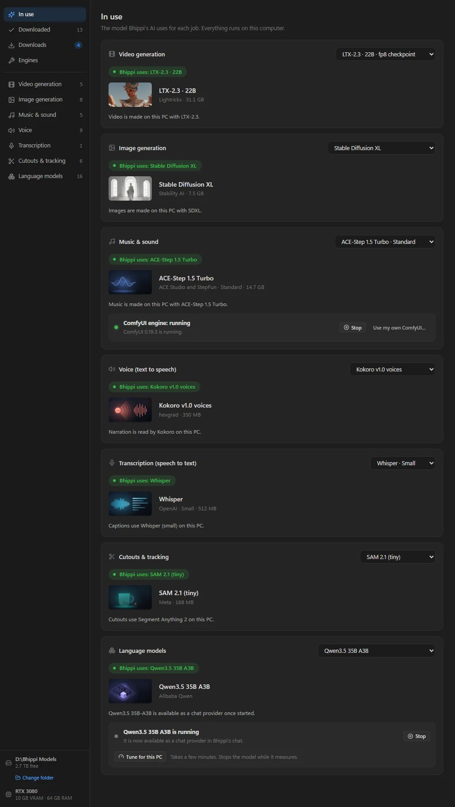<br />
  <em>In use: one model per job, picked from each dropdown, where <strong>None</strong> turns that job off.</em>
</div>

Every downloaded model has a **Use for…** button, and the **In use** page shows the whole picture. When you ask the co-pilot for a clip, a picture, a song, a voice-over or captions, it uses the model in use for that job and writes the prompt in the form that model expects (MiniMax H3's shot and dialogue format, for example). If a job is set to **None**, the AI says so plainly instead of guessing.

### Language models from Hugging Face

<div align="center">
  <table>
    <tr>
      <td width="50%" align="center">
        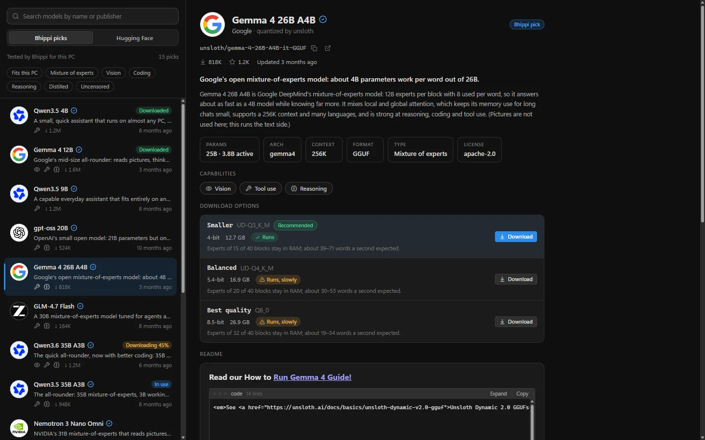<br />
        <em>Bhippi picks, or search all of Hugging Face, with each maker's logo.</em>
      </td>
      <td width="50%" align="center">
        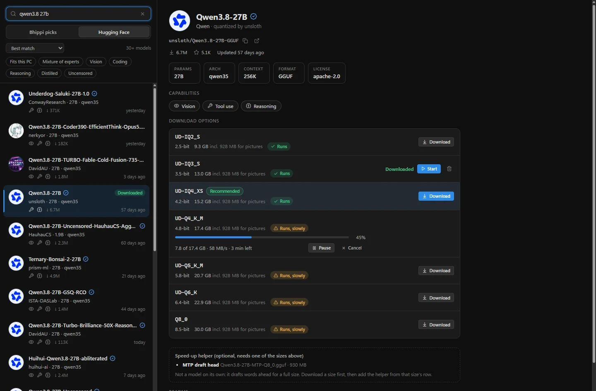<br />
        <em>Every size with its bits, file size and fit, and live progress while it downloads.</em>
      </td>
    </tr>
  </table>
</div>

- **Bhippi picks** are models tested for this kind of work (Qwen3.5/3.6/3.8, Gemma 4, gpt-oss, GLM-4.7 Flash, Nemotron and more). **Hugging Face** searches every GGUF model there, sorted by *Best match*, *Most downloads*, *Trending*, *Most liked* or *Recently updated*.
- **Quick filters:** *Fits this PC*, *Mixture of experts*, *Vision*, *Coding*, *Reasoning*, *Distilled* and *Uncensored*.
- **Gated models** (Llama, Gemma and others): sign in to Hugging Face from inside Bhippi and accept the model's terms. Your token is kept in the Windows credential store and is only ever sent to huggingface.co.
- **Big models on normal PCs.** Mixture-of-experts models only use a small part of themselves for each word. Bhippi keeps the part used every time on the graphics card and the rest in system RAM (llama.cpp's `--n-cpu-moe`, sized to your card), so models far bigger than your GPU still run at a usable speed.
- **Speed-ups.** Speculative decoding with MTP and EAGLE3 helper files (shown as optional *Speed-up helpers*, never as models of their own), prompt caching, and **Tune for this PC**, which measures real speeds on your machine and keeps the fastest settings.
- **Qwen3.8 Flash Next** (125B mixture of experts) runs through [Strata](https://github.com/Niko1221/Strata), installed and started by Bhippi.
- A started model becomes a provider in the chat, so the co-pilot can run entirely on your PC.

### Downloads: queue, pause and resume

<div align="center">
  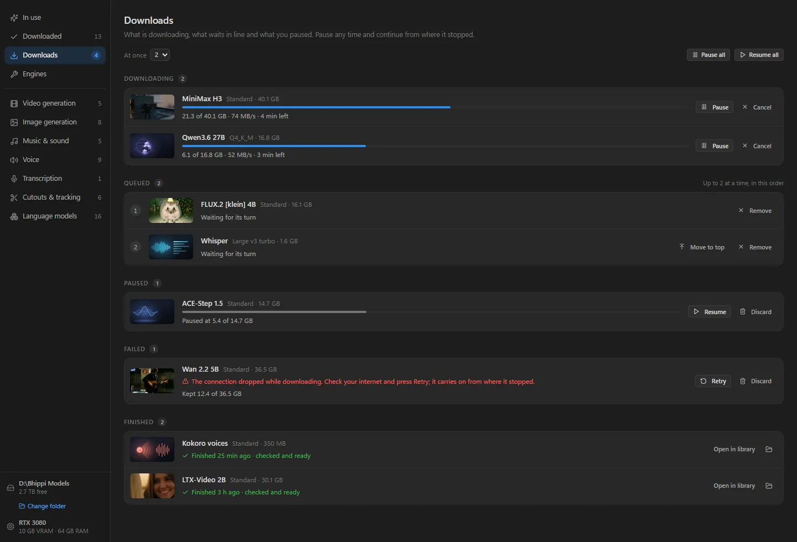<br />
  <em>Downloads: what is running, what is next, and what is paused, failed or finished.</em>
</div>

| Section | What you see | What you can do |
| :--- | :--- | :--- |
| **Downloading** | Progress bar, "1.2 of 5.0 GB · 38 MB/s · 2 min left" | Pause, Cancel |
| **Queued** | The order downloads will start in | Move to top, Remove |
| **Paused** | How much is already on disk | Resume (from where it stopped), Discard |
| **Failed** | The reason in plain words (no space left, connection lost, checksum mismatch) | Retry |
| **Finished** | Recent downloads, checked | Open in library, Show folder |

**How it works:**
- **One at a time by default.** Downloads wait in a queue and start in order, so a big model doesn't slow down everything else. You can let up to three run at once.
- **Resume, not restart.** Each file is written to a `.part` file next to its final place. Pausing keeps it; resuming asks the server for only the missing bytes (an HTTP `Range` request). A 40 GB model paused at 30 GB continues from 30 GB.
- **Safe after closing Bhippi.** Downloads that were running or waiting come back as *Paused* the next time you open Bhippi, and continue only when you press **Resume**.
- **Checked before use.** Every finished file is checked against its published SHA-256 checksum. A file that doesn't match is removed and reported, never used.
- **Space is checked first.** A download only starts if the drive has room for it plus 2 GB.
- **Always visible.** The **Downloads** badge in the bottom-right corner shows progress from anywhere in the app and links to the full page. Engine, voice and AI-pack downloads appear there too.

For how the library is built (catalog, ComfyUI graphs, llama.cpp plans), see [docs/model-library.md](docs/model-library.md).

---

## 🔍 Interface Tour

<div align="center">
  <table>
    <tr>
      <td width="50%" align="center">
        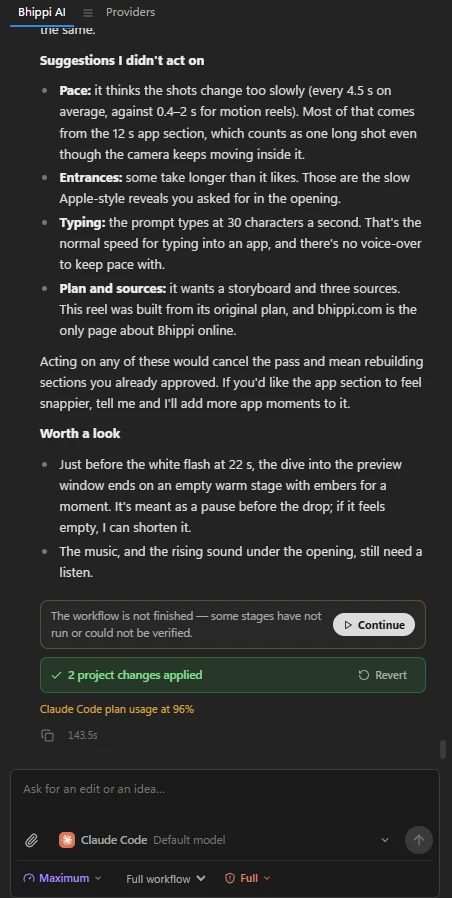<br />
        <strong>AI Co-Pilot & Chat</strong><br />
        <em>Connect Claude Code, Codex, OpenAI, or local Ollama. Phase-guarded workflow with one-click actions.</em>
      </td>
      <td width="50%" align="center">
        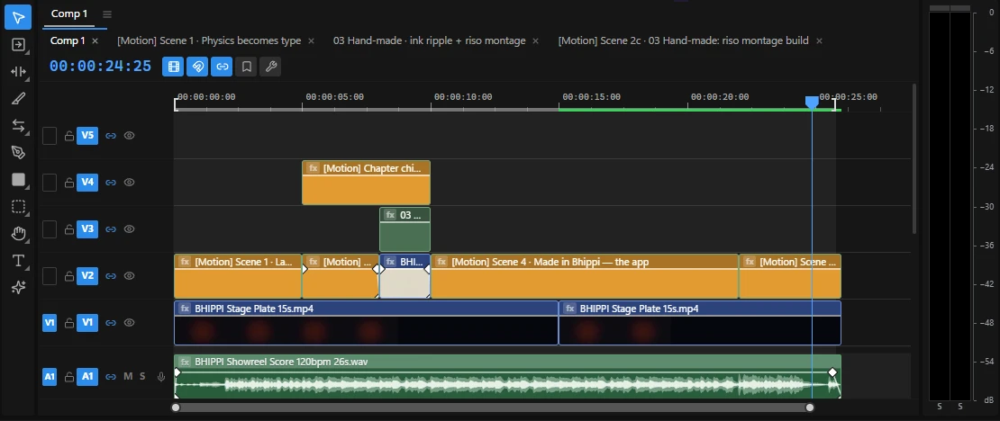<br />
        <strong>Multi-Track Timeline</strong><br />
        <em>Audio waveforms, clip markers, ripple/roll trimming, track locks, and beat-snapping guides.</em>
      </td>
    </tr>
    <tr>
      <td width="50%" align="center">
        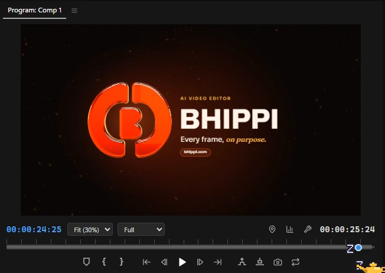<br />
        <strong>Program & Canvas Monitor</strong><br />
        <em>Interactive transform handles, safe-title overlays, annotation pencil, and real-time playback.</em>
      </td>
      <td width="50%" align="center">
        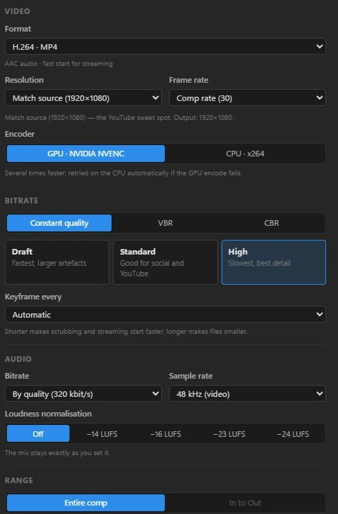<br />
        <strong>Export & Render Queue</strong><br />
        <em>Presets for YouTube 4K/1080p, TikTok/Reels 9:16, square, ProRes, and background batch rendering.</em>
      </td>
    </tr>
  </table>
</div>

---

## 📊 How it compares

Bhippi combines four discrete workflows into a unified native application: an NLE editor, a motion graphics compositor, an autonomous AI producer, and a local generative engine.

### Editing & Production

| Feature | Bhippi | Premiere Pro | DaVinci Resolve | CapCut | Runway |
| :--- | :---: | :---: | :---: | :---: | :---: |
| **Multi-track NLE** *(ripple, roll, slip, slide, nesting)* | ✅ | ✅ | ✅ | Basic | — |
| **AI that edits timeline via undoable operations** | ✅ | Assistive only | Assistive only | Assistive only | — |
| **Structured Plan → Gather → Edit → Polish pipeline** | ✅ | — | — | Fixed templates | Prompt to video |
| **Transcript-based cutting & sync captions** | ✅ *(Local)* | ✅ | ✅ *(Studio)* | ✅ *(Cloud)* | — |
| **Beat, bar & phrase-aware cut snapping** | ✅ | Partial | Partial | Auto-beat | — |
| **Automated Frame QA** *(safe area, face obstruction, blank frames)* | ✅ | — | — | — | — |
| **Media download** *(YouTube, Instagram, TikTok, X)* | ✅ | — | — | — | — |

### Motion Graphics & 3D

| Feature | Bhippi | After Effects | Resolve (Fusion) | Remotion | Runway |
| :--- | :---: | :---: | :---: | :---: | :---: |
| **Keyframed layers, masks, mattes & blend modes** | ✅ | ✅ | ✅ *(Nodes)* | In code | — |
| **2.5D spatial layers & camera depth-of-field** | ✅ | ✅ | ✅ | In code | — |
| **Vector shapes, trim paths, path operations** | ✅ | ✅ | Partial | In code | — |
| **Natural language scene synthesis from chat** | ✅ | — | — | LLM code-gen | Generative clips |
| **Real 3D render pipeline** *(glass, metal, lights)* | ✅ *(Headless Blender)* | ✅ *(Advanced 3D)* | ✅ *(Fusion 3D)* | ✅ *(Three.js)* | Generative |
| **Component template library** | **60+ engine, 500+ HTML** | Marketplace | Templates | Community | — |
| **Global Brand Kit applied to all graphics** | ✅ | CC Libraries *(Manual)*| — | — | — |

### Privacy & Economics

| Aspect | Bhippi | Premiere / AE | DaVinci Resolve | CapCut | Runway |
| :--- | :---: | :---: | :---: | :---: | :---: |
| **Media stays strictly on local storage** | ✅ | Partial *(Cloud AI)* | ✅ | — | — |
| **Local Text-to-Video & Image synthesis** | ✅ | Cloud *(Firefly)* | — | Cloud | Cloud |
| **Local rotoscoping & subject cutout** | ✅ | Roto Brush | Magic Mask *(Studio)* | Cloud cutout | Cloud |
| **Local neural voice-over** | ✅ | — | — | Cloud | Cloud |
| **Pricing model** | **Free & Open Source** | Monthly subscription | Free / $295 Studio | Subscription + cloud | Credit subscription |

---

## 🧠 How the AI works

The co-pilot adapts to whichever model you connect: **Claude** (Claude Code, Anthropic API), **OpenAI / Codex**, local LLM servers (**Ollama**, **vLLM**, **LM Studio**), or custom API endpoints.

```
       ┌─────────────────┐
       │   User Prompt   │
       └────────┬────────┘
                │
                ▼
      ┌──────────────────┐
      │  Workflow Guard  │ ◄─── Ensures honest phases (no editing before planning)
      └─────────┬────────┘
                │
     ┌──────────┴──────────┐
     ▼                     ▼
┌──────────────┐    ┌──────────────┐
│ Frontier Tier│    │ Guided Tier  │
│(Opus, GPT-5) │    │(Local, 8B-70B│
└──────┬───────┘    └──────┬───────┘
       │                   │
       ▼                   ▼
┌──────────────────────────────────┐
│  200+ Native Timeline AI Tools   │
│  (Cuts, Rotoscoping, Audio, SFX) │
└──────────────────┬───────────────┘
                   │
                   ▼
┌──────────────────────────────────┐
│   Undoable Project State Bin     │
│   (Saved inside project folder)  │
└──────────────────────────────────┘
```

### Essential Tool Categories

| Domain | Key Tools |
| :--- | :--- |
| **Inspection** | `get_comp`, `analyze_clip_speech`, `inspect_clip_frames`, `run_frame_qa`, `review_frames` |
| **Planning** | `online_research`, `save_video_blueprint`, `save_storyboard`, `query_frame_atlas` |
| **Asset Gathering** | `generate_local_media`, `synthesize_speech_voiceover`, `download_online_media`, `scrape_videos`, `capture_app_session` |
| **Audio & SFX** | `analyze_song`, `analyze_music_beats`, `compose_music`, `sound_the_motion`, `level_audio` |
| **End-to-End Films** | `build_edit_from_brief`, `apply_recipe`, `create_product_demo`, `judge_edit` |
| **Timeline Editing** | `apply_edit`, `place_clip`, `snap_cuts_to_beats`, `rotoscope_clip`, `erase_subject_clip` |
| **Motion & Compositing** | `motion_guide`, `create_motion_scene`, `update_motion_scene`, `search_icons`, `track_motion` |
| **3D Rendering** | `list_3d_presets`, `render_3d_scene` *(headless Blender bridge)* |
| **Graphics & Text** | `create_motion_graphic`, `react_bits`, `add_text`, `add_captions` |
| **Brand Management** | `list_brand_kits`, `get_brand_kit`, `create_brand_kit`, `apply_brand_kit`, `render_brand_board` |

---

## 🚀 Quick Start

### Installation

Download the latest installer directly from **[bhippi.com](https://bhippi.com)** or build from source:

#### System Requirements
- **OS:** Windows 10/11 (x64)
- **Node.js:** v20.x or v22.x
- **Rust:** 1.85+
- **FFmpeg:** Installed and available on your system `PATH`
- *Optional:* [Blender 4.2+](https://www.blender.org) for 3D rendering; Python 3.10+ with PyTorch for local AI models.

#### Building from source

```bash
# 1. Clone the repository
git clone https://github.com/memegyanfactory-gif/bhippi-Video-editor.git
cd bhippi-Video-editor

# 2. Install dependencies
npm install

# 3. Launch the desktop application in development mode (hot-reload enabled)
npm run dev

# Or run the browser-only UI preview
npm run dev:web
```

### Initial Configuration
1. Open **Settings → AI providers** to connect your preferred model (API key, Claude Code CLI, or local server).
2. Open **Settings → Model Library** to download local models (video, images, music, voices, Whisper, cutouts, language models) and choose which one the AI uses for each job under **In use**.
3. If you have Blender installed, ensure its path is registered under **Settings → 3D** to unlock the 3D generator.

---

## 🛠️ Architecture & Codebase

```bash
npm run typecheck    # Validate TypeScript types across frontend
npm run test:ui      # Run Vitest test suite
npm test             # Run Vitest + Cargo test suite
npm run lint         # ESLint (Rust: npm run lint:rust, advisory)
npm run bundle       # Package full production NSIS installer
```

### Directory Map

| Path | Purpose |
| :--- | :--- |
| `src/editor/` | Core NLE UI: timeline, canvas monitors, trimmer, audio tracks, and transport controls |
| `src/motion/` | GPU WebGL2 compositor: scene graph, bezier keyframes, 2.5D camera, vector trees |
| `src/lib/aiTools.ts` | The 200+ native AI tool implementations invoked by the co-pilot |
| `src/lib/editWorkflow.ts` | Phase guard ensuring deterministic transitions between planning, gathering, and cutting |
| `src/lib/blender3d.ts` | Headless Blender subprocess bridge, scene templates, and Cycles render dispatch |
| `src/lib/filmRecipes.ts` | Complete film templates (product demo, kinetic explainer, SaaS walkthrough) |
| `src/lib/rbx/` | Component library containing React Bits, Animate.css, and interactive UI widgets |
| `src/lib/brandKit/` | Brand kit management, archetypes, color palettes, and typographic scales |
| `src/settings/ModelLibrary.tsx`, `src/settings/library/`, `src/settings/llm/` | The Model Library screens: categories, In use, Downloaded, Downloads, Engines and the Hugging Face browser |
| `src-tauri/src/model_library.rs`, `model_library/queue.rs` | Model catalog, resumable SHA-256-checked downloads and the download queue |
| `src-tauri/src/comfy.rs`, `llm_runtime.rs`, `llm_hub.rs`, `strata.rs`, `hf_auth.rs` | ComfyUI engine, llama.cpp runtime and tuning, Hugging Face search, Strata, Hugging Face sign-in |
| `src-tauri/catalog/library/` | The model catalog (JSON): sizes, files, checksums, licences, prompt rules |
| `src-tauri/src/` | Native Rust backend: project state serialization, FFmpeg pipelines, local model workers |
| `docs/` | Deep-dive architectural specs: [Model Library](docs/model-library.md), [Motion Engine](docs/MOTION-ENGINE.md), [Brand Kit](docs/BRAND-KIT.md), [React Bits](docs/REACT-BITS-LIBRARY.md) |

---

## 💬 Community

Join the **[Bhippi Discord](https://discord.gg/WY3XNWdf9B)** to ask questions, share what you made, report bugs, suggest features and hear about new releases first.

<a href="https://discord.gg/WY3XNWdf9B"></a>

Found a bug? You can also open an [issue on GitHub](https://github.com/memegyanfactory-gif/bhippi-Video-editor/issues).

---

## 📄 License

Bhippi Video Editor is open source software licensed under the **[MIT License](LICENSE)**.
